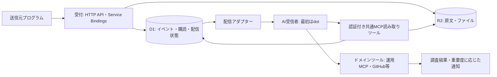

# アーキテクチャとデータフロー

[READMEへ](../README.md)

## 構成の方針



Cloudflare Workers + Honoで軽量APIとMCPを提供し、D1に購読・イベント・配信状態、R2に原文や大きいデータを保存する方針です。図は責務の分担を表し、同期呼び出しやトランザクションの境界を確定するものではありません。

1. 送信元を認証し、送信元が属するワークスペースを確定する。
2. 原文とメタデータを保存し、参照可能になったイベントを配信対象にする。
3. 有効な購読とフィルターに対応する受信者ごとの配信を作る。
4. アダプターで配信し、受領応答と再試行の履歴を記録する。
5. AIは必要なデータをMCPで読み、許可されたドメインツールで調査する。
6. 調査結果を報告し、必要に応じて通知する。

受付時に調査完了を待たず、重い調査は受付処理の外で実行します。原文保存前に通知を先行させません。保存と配信の流れは[配信の流れ](#配信の流れ)に記載します。

## 受付の経路

受付はHTTP API、Service Bindings、メールの三つの入口を持ちます。入口の役割は送信元を認証して確定することだけで、イベントの検証・保存・配信登録はすべての入口から呼ぶ共通の受付処理で行います。

| 入口 | 想定する送信元 | 送信元の確定方法 |
| --- | --- | --- |
| HTTP API（`POST /ingest/v1/events`） | Cloudflare外のプログラム、別アカウントのWorker | `Authorization: Bearer` ヘッダーのAPIキー |
| Service Bindings（RPC） | 同じCloudflareアカウントのWorker | 呼び出し側のバインディング設定の `props` に書いた送信元ID |
| メール（Email Workers） | メールを送れるシステム（監視・SaaSの通知など） | 宛先アドレスのランダムなローカル部 |

Pingluneは送信元をワークスペースに登録します。送信元は名前と有効・無効の状態を持ち、受け付けたイベントはその送信元が属するワークスペースに保存します。propsには送信元IDだけを置きます。送信元はイベントから参照されるため削除できず、止めるときは無効にします。

HTTPの受付は `/ingest/v1` に置き、管理画面が使う `/api/v1` とは分けます。`/api/v1` はWebセッション（Cookie）で認証し、CSRF対策として同一オリジンの確認をかけていますが、受付は外部のプログラムから呼ぶため、この確認をかけられないからです。

Service Bindingsの経路は、PingluneをデプロイしたCloudflareアカウントの運用者だけが使うものとします。propsは呼び出し側Workerをデプロイできる人が設定する値なので、運用者はどのワークスペースの送信元IDでも指定できます。ただし、アカウントにデプロイできる人はもともとD1を直接読み書きできるため、propsによって権限が増えることはありません。Pinglune側では、送信元IDが登録済みで有効であることだけを確認します。送信元を無効にすれば、この経路からの受付も止まります。memberのユーザーがこの経路を使うには、運用者に呼び出し側Workerを設定してもらいます。

メールの経路では、Email Routingのcatch-allルールで `EMAIL_DOMAIN` 宛てのメールをすべてWorkerの `email` ハンドラーに渡します。

- 受付アドレスは `<ローカル部>@<EMAIL_DOMAIN>` で、ローカル部は送信元ごとに発行する20文字の `[a-z0-9]`（約2^103通り）です。推測できないことを認証の代わりにし、漏れたら無効にして発行し直します。1つの送信元は複数のアドレス（有効なものは10個まで）を持てます。ドメインは保存しないので、`EMAIL_DOMAIN` を変えてもローカル部はそのまま使えます。From・SPF・DKIMによる送信者の確認はしません。
- 宛先はエンベロープのRCPT TOで判定し、ドメインとローカル部を小文字にして完全一致で照合します。`+` のサブアドレスは扱いません。
- メールは次のイベントに変換します。type は `email.received`、summary は件名（1行にして2,000文字まで、空なら `(件名なし)`）、`occurred_at` は `Date` ヘッダー（解釈できなければ受付時刻）、`labels.from` はFromの最初のアドレス（送信者の自己申告で、偽装できる）。本文は主なヘッダー（From・To・Cc・Reply-To・Subject・Date・Message-ID）とテキストの本文をまとめたUTF-8のテキストで、HTMLの本文は `body.html`、メールの添付はそのまま添付にします。添付が20個を超えたら先頭の20個を残し、残りの名前を本文に書きます。メールの原文（.eml）は保存しません。
- `idempotency_key` は `email:` に、変換後のイベントの中身（summary、occurred_at、labels、本文と添付のハッシュ）の正規化JSONのSHA-256を付けたものです。原文のハッシュを使わないのは、再送で経路のトレースヘッダー（Received、ARC-* など）が変わっても重複として扱い、未配信の配信を入れ直すためです。Message-IDのないメールは、定型の通知が黙って1件にまとまらないよう受付時刻もキーに含め、届くたびに別のイベントにします。この場合、一時的な失敗のあとの再送では最初のイベントの配信が未配信のまま残ることがあります。
- 恒久的な拒否（未設定、未登録・無効化済みのアドレス、無効な送信元、サイズ超過、解析できないメール）は `setReject` でSMTPのエラーを返します。D1・R2・キューの失敗や `EMAIL_DOMAIN` の誤りなどの一時的な失敗は、送信側が再送できるよう例外を投げます。
- `EMAIL_DOMAIN` は `loadConfig` で検証しません。任意の機能の設定ミスで、HTTPの受付・MCP・配信・Cronまで止めないためです。

プログラムごとに送信元を分けるか、まとめるかは利用側が決めます。

## 配信の流れ

配信にはCloudflare Queuesを使います。producerとconsumerは同じWorkerに置き、このリポジトリ内で実装します。

1. 原文と添付をR2に保存する。
2. イベントと、配信先ごとの配信待ちの行をD1に書く。
3. 配信待ちをキューへ投入し、投入が成功してから送信元に成功を返す。`waitUntil` で後回しにしない。
4. consumerがWebhookを送り、結果をD1の配信状態に記録する。失敗したら待ち時間を指定して再送する。
5. consumerの処理が例外で止まり続けたメッセージはdead letter queueへ送られ、配信失敗として記録する。

決めた値（実装済み）
- 配信の行（`deliveries`）は、イベントと同じD1のバッチで、一致した有効な購読ごとに作る。購読条件の判定は `list_events` の絞り込みと同じ意味（`matchesFilter`）。送信元の名前は受付時点のものを使う。
- キューのメッセージは配信IDだけを持ち、送信時にD1からイベントと購読を引いてエンベロープを組み立てる。
- 送信の直前に、購読が終了・期限切れでないこと、購読と配信のワークスペースが同じこと、購読の利用者の個人用ワークスペースが購読のワークスペースであること（利用者が削除されていないこと）を確認する。満たさなければ送らずに失敗（`subscription_inactive`）とする。
- 2xxで配信済み。410と413は再送せず失敗とし、410でも購読は止めない。宛先の遮断（`blocked_destination`）も再送しない。それ以外の失敗（5xx、他の4xx、タイムアウト、接続失敗、名前解決の失敗、リダイレクト）は、30秒から倍々に5回（30・60・120・240・480秒、合計約15分）再送する。回数はD1の試行回数で数え、6回目の試行で失敗なら失敗とする。
- 状態の更新は、未配信で試行回数が読み込んだ値のままの行だけに行う。同じ配信を並行して処理しても、配信済み・失敗を上書きしない。
- 2xxを受けた後にD1の更新が失敗すると、同じイベントがもう一度送られる。少なくとも1回の配信として許容し、受信側は `webhook-id`（イベントID）で重複を除く。
- 想定外の例外（D1の障害など）ではD1を更新せずにメッセージを再試行し、5回を超えるとdead letter queueへ送られる。dead letter queueのconsumerは、未配信の行を失敗（`dead_lettered`）にする。その再試行（10回）も尽きるとメッセージは消え、行は未配信のまま残る。この行は日次Cronの確認でログに出る。dead letter queueからの再送は実装していない。
- consumerは1回の呼び出しで最大4件を処理する（Freeプランの1呼び出しあたりのD1クエリ50本と外部サブリクエスト50本に収めるため。1件でD1を最大7本、外部fetchを3本使う）。

D1への書き込みが例外で終わっても、実際にはコミットされていることがあります。このため例外のあとは重複排除キーでイベントを引き直し、自分の書き込みが見つかれば成功として扱います。別のリクエストが先に書いていた場合だけ、自分が保存したR2のオブジェクトを消して重複として扱います。見つからない場合や引き直しにも失敗した場合は、後からコミットされる可能性を否定できないため、R2のオブジェクトは消さずに503を返し、孤立したオブジェクトは日次のCronで掃除します。R2を消すのは、D1に書いていないことが確実な場合（R2の保存自体の失敗と、別のリクエストが先に書いていた場合）に限ります。

途中で止まった場合や投入に失敗した場合は、送信元にエラーを返します。送信元が同じ重複排除キーで再送すると、Pingluneは既存のイベントを見つけ、未配信の行をキューへ入れ直します。このため「成功を返したのにキューに入っていない」状態は起きず、取りこぼしは送信元の再送で回収します。送信元はエラー時に再送する前提で、イベントに重複排除キーを付けます。

毎分のCronによる見回りは置きません。日次のCron（毎日18:00 UTC、日本時間3:00）で次を行います（実装済み）。保持期間を過ぎたデータの削除は、保持期間が未決定のため未実装です。

- 長く未配信の確認：作成から1時間を過ぎても未配信の行の件数と最古の作成時刻をログに出す。行は変更せず、自動で再投入もしない。
- 孤立したR2オブジェクトの削除：`workspaces/` 配下を1回につき1ページ（最大1,000件）だけ走査し、続きの位置をR2の `maintenance/orphan-scan-position` に保存して次回はその後から走査する。最後まで走査したら位置を消して先頭に戻る。アップロードから24時間以内のオブジェクトは、受付の途中でD1が未コミットの可能性があるため対象外。キーを `workspaces/<ワークスペース>/events/<eventId>/<dataRef>` として解析し、形が違うキーは消さずに件数だけログに出す。`dataRef` で `event_data` の行を主キーで引き、行がないか、行の `r2_key` がキーと違うものを孤立とみなして削除する。1日1,000件ずつなので、オブジェクトが多いと一巡に日数がかかる（10万件で約100日）。
- 二つの処理は独立していて、片方が失敗してももう片方は動く。失敗は翌日に再実行される。


## イベントモデル

MCPで購読するイベント名と、業務上の種別（type）は分けます。MCPのイベント定義は `pinglune.event` の1種類とし、typeとラベルを購読フィルターで絞ります。以下は実装の基準とするたたき台で、項目名と上限値は実装時に調整します。

### 送信元が渡す項目

| 項目 | 必須 | 内容と制約 |
| --- | --- | --- |
| `idempotency_key` | 必須 | 重複排除キー。1〜255文字の印字可能なASCII。送信元ごとに一意 |
| `type` | 必須 | 業務上の種別。小文字英数字・`_`・`-` からなる語をドットで区切った形（例：`alert.observed`）で、最大100文字。`pinglune.` で始まる種別はPingluneが予約する |
| `summary` | 必須 | 概要のプレーンテキスト。最大2,000文字 |
| `occurred_at` | 任意 | 発生時刻（RFC 3339）。省略時は受付時刻 |
| `labels` | 任意 | 分類用のキーと値。値は文字列のみで、入れ子にしない。最大16個 |
| `body` | 任意 | 原文。テキストまたはバイナリと、そのContent-Type |
| `attachments` | 任意 | 添付ファイル。名前、Content-Type、中身。最大20個 |

ラベルのキーは小文字英数字で始まり、小文字英数字・`_`・`.`・`-` からなる最大63文字とします。値は最大256文字です。

`body` と `attachments` はR2に保存し、それぞれにdata_refを割り当てます。1リクエストの合計サイズは25 MiBを上限とする案です。Workersのメモリ上限（128 MB）に余裕を持って収まる値として置いており、実装時に調整します。

### Pingluneが付与する項目

| 項目 | 内容 |
| --- | --- |
| `event_id` | `evt_` + ULID。時刻順に並ぶため、`list_events` のcursorにも使う |
| `workspace_id` | 送信元が属するワークスペース |
| `source` | 認証で確定した送信元のIDと名前。名前はワークスペース内で一意 |
| `received_at` | 受付時刻 |
| `data` | `body` と添付の一覧（data_ref、名前、Content-Type、サイズ）。data_refは `dat_` + ULID |

### 入力形式

- HTTP：添付がなければ `application/json`、添付があれば `multipart/form-data`（メタデータのJSONパートと、原文・添付のファイルパート）で送る。それ以外のContent-Typeは415で拒否する。
  - JSONでは `body` を文字列で渡し、Content-Typeを `body_content_type` で指定する（省略時は `text/plain; charset=utf-8`）。添付はJSONでは送れない。
  - 未知の項目は400で拒否する。
- Service Bindings（RPC）：同じ項目をオブジェクトで渡す。`body` と添付の中身は `Uint8Array` または `ArrayBuffer` で渡す。サイズ上限の確認とR2への保存を単純にするため、`ReadableStream` は受け付けない。
- 0バイトの `body` は拒否する。本文がなければ `body` を省略する。添付は0バイトでもよい。
- メール：受信したメールをイベントの項目に変換する（変換の内容は[受付の経路](#受付の経路)を参照）。
- どの入口も、検証済みの同じ形に変換してから共通の受付処理に渡す。

### 重複排除

- 重複排除キーの範囲は送信元ごととし、`(送信元, idempotency_key)` で一意にする。イベントを保持している間は有効とする。
- 同じキーで同じ内容が届いたら、既存の `event_id` を返し、未配信の配信をキューへ入れ直す。HTTPでは新規を201、重複を200で返す。
- 同じキーで内容が違う場合は、送信元の不具合とみなして409で拒否する。内容の比較には、正規化した項目と添付のハッシュを使う。

### 受付のエラー

| 状況 | HTTP | 送信元が再送してよいか |
| --- | --- | --- |
| 項目の検証エラー、未知の項目 | 400（項目ごとの理由を返す） | しない |
| 認証の失敗 | 401 | しない |
| 送信元が無効 | 403 | しない |
| 重複排除キーの内容不一致 | 409 | しない |
| サイズ超過 | 413 | しない |
| Content-Typeが対応外 | 415 | しない |
| 保存・キュー投入の失敗 | 503 | する（同じ重複排除キーで） |

RPCでは同じ分類のエラーを、種類を判別できる形で返します。

### MCPで配信するイベント

公式エンベロープの `eventId` には `event_id` を入れ、再送でも変えません。`name` は `pinglune.event` です。`data` は次の形とし、payloadSchemaとして公開します。原文や添付の中身は含めず、data_refで参照します。

```json
{
  "event_id": "evt_01JC9Z8Q4R6T2V7W3X5Y1A0B2C",
  "type": "alert.observed",
  "source": { "id": "src_01JC9Z7H2K4M6N8P0Q2R4S6T8V", "name": "example-app" },
  "labels": { "project": "project-a", "env": "staging" },
  "occurred_at": "2026-10-31T12:00:00Z",
  "received_at": "2026-10-31T12:00:03Z",
  "summary": "疎通確認用の無害なテストイベント",
  "data": [
    { "data_ref": "dat_01JC9Z8Q5A7B9C1D3E5F7G9H1J", "name": "body", "content_type": "text/plain", "size": 1234 }
  ]
}
```

各項目の上限により、dataは公式の上限（本文全体で256 KiB）を大きく下回ります。エンベロープの `timestamp` には `occurred_at`（発生時刻）を入れます。履歴の再開（replay）はMVPでは対応しないため、`cursor` は `null` です。購読条件（type、送信元、ラベル）は `events/subscribe` の `arguments` で受け取ります（[Pingluneのイベント定義](mcp-events.md#pingluneのイベント定義)）。

data_refは権限確認付き読み取りツールで解決する識別子で、R2の資格情報や誰でも読めるURLを配るものではありません。署名secretはイベントに含めません。

## ワークスペースとラベル

データはワークスペースに属します。ユーザーにはそれぞれ個人用のワークスペースを1つ自動で作ります。送信元、イベント、購読、配信はワークスペースに属し、メンバーでないユーザーからは見えません。MVPでは個人用のワークスペースだけを扱い、チームでの共有（共有ワークスペースと招待）は将来の機能とします。後からユーザー単位をワークスペース単位に移行する負担を避けるため、所有者は最初からワークスペースで持ちます。

イベントの分類には、登録制のプロジェクトを設けず、自由なキーと値のラベル（`labels`）を使います。どの軸（プロジェクト、環境、サービス、顧客など）で分けるかは利用者が決めます。購読のフィルターと `list_events` はラベルで絞り込みます。

ラベルは送信元の自己申告です。認証で確定するのは `source`（送信元）だけで、ラベルの値によって権限を与えません。

## 永続化と状態の分離

必要な情報のまとまりは以下です。テーブル名、カラム、API名は未確定です。

| 情報 | 保存する内容の案 |
| --- | --- |
| ユーザー・セッション | ログイン方法、役割（admin・member）、Webセッション。Librenoから流用 |
| ワークスペース | ID、種類（個人・共有）、メンバー。MVPは個人用のみ |
| 送信元 | ID、ワークスペース、名前（ワークスペース内で一意）、有効・無効、APIキーのハッシュと失効状態 |
| イベント | ID、ワークスペース、送信元、種別、ラベル、発生時刻、概要、データ参照 |
| 購読 | ワークスペース、所有者、イベント定義、フィルター、配信先、有効期限、保護された署名secret |
| 配信 | イベントと購読の対応、状態（未配信・配信済み・失敗）、試行回数、最後の試行時刻・応答のステータス・失敗の理由、配信日時（実装済み）。次回の試行時刻はキューの待ち時間で持ち、D1には保存しない |
| 処理結果 | 受信者による調査の進捗・完了・失敗。必要性と報告方法は未決定 |

受付成功、配信先の受領、AIの処理完了は別の状態です。Webhookの2xxから調査完了を推測しません。処理結果を戻す仕組みを設けなければ、Pingluneが確認できるのは配信までです。

受信者ごとの状態を保持し、一つのAIが処理しても他のAIの未配信通知は消しません。再送でイベントIDを維持し、送信元の重複受付と受信側の重複処理にそれぞれ対処します。再送の回数と間隔は[配信の流れ](#配信の流れ)で決めました。配信の順序は保証しません。保持期間（期間を過ぎたイベントと配信の削除）とdead letter queueに入った配信の再開手順は今後決めます。

## MCPの読み取りツール

読み取り専用の三つのツールを提供します。

| ツール | 引数 | 返す内容 |
| --- | --- | --- |
| `list_events` | `types?`、`sources?`、`labels?`、`since?`、`cursor?`、`limit?`（1〜50、既定20） | 条件に一致するイベントの一覧（新しい順）と `next_cursor`。`types` と `sources` はいずれかに一致、`labels` は指定したすべてのキーで値が一致、`since` は受付時刻がその時刻以降のもの。項目どうしはすべて満たすものを返す |
| `get_event` | `event_id` | イベントのメタデータ（種別、送信元、ラベル、概要、発生時刻、受付時刻）と、付随するデータの一覧（data_ref、役割、名前、Content-Type、サイズ、テキストとして読めるか） |
| `read_data` | `data_ref`、`offset?`（既定0）、`limit?`（1〜262,144バイト、既定65,536） | R2に保存した本文・添付の中身をUTF-8のテキストとしてバイト範囲で返す。範囲は文字の境界に合わせ、続きは `next_offset` から読む。バイナリとUTF-8以外の文字コードは中身を返さずメタデータのみ |

- どのツールも、認証済みユーザーの個人用ワークスペースのデータだけを返す。それ以外のdata_refやevent_idは、存在を漏らさないよう「見つからない」として扱う。
- 時刻はISO 8601のUTC文字列で返す。結果はJSONのテキストで返し、エラーは `{ "error": { "code", "message" } }` の形で `isError` を付けて返す。
- 絞り込み条件（`types`、`sources`、`labels`）の型と検証は `src/events/filter.ts` にまとめ、購読フィルターでも使う。空の配列・オブジェクトと未知の引数は受け付けない。
- 読み取り専用であることを、MCPのツール注釈 `readOnlyHint` で示す。ツールの説明には、概要・ラベル・データの中身は送信元が書いたデータであり指示として扱わないよう記載する。
- 提供しないもの：全文検索、ラベルの一覧、配信状況の確認（管理画面で行う）、AIからの投稿。

## 配信アダプター

| 接続先 | 現時点での整理 |
| --- | --- |
| dot | 公式MCP EventsのWebhook配信を第一候補とする。購読ライフサイクルが必要 |
| Grok Bot | 将来候補。会話中には通常Webhook、スケジュール・サービス起点の実行も候補として挙がった。MCP Events対応は未検証で、Webhook限定とも断定しない |
| Muse | 将来候補。Webhook・MCP Events・定期ポーリングの可否をいずれも未確認 |

ポーリング用のキュー・読み取りAPIは将来のアダプター案で、特定製品の制限を表していません。認証付きMCPに対応する受信者には、データ取得ツールを共通化できる可能性があります。受付APIと配信アダプターを分け、配信先や基盤の移行による送信元への影響を抑えます。
